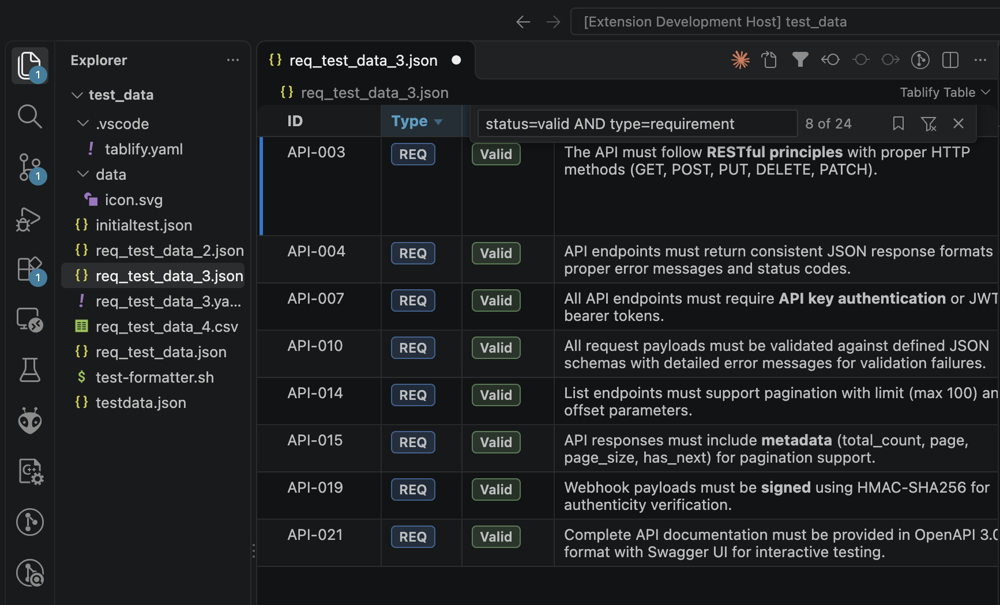

# Tablify

A VS Code extension that opens JSON, YAML and CSV files as an interactive, filterable table,
and log files as a sortable, filterable table of log events.



[Recording of Tablify](https://github.com/user-attachments/assets/f11cfb34-4c39-4f40-9068-d628a83d4668)

## Supported files

Tablify reads `JSON`, `YAML` and `CSV`/`TSV` files whose top level is either a **list** of entries
or a **hash** of ID → entry:

```json
[
  { "id": "REQ-001", "type": "requirement", "status": "valid" },
  { "id": "REQ-002", "type": "requirement", "status": "draft" }
]
```

```json
{
  "REQ-001": { "type": "requirement", "status": "valid" },
  "REQ-002": { "type": "requirement", "status": "draft" }
}
```

The same two shapes work in YAML:

```yaml
- id: REQ-001          # list
  status: valid

REQ-001:               # hash: the key becomes the `id` column
  status: valid
```

Any other shape shows a "Not a table file" message with an **Open as Text** button.

**CSV and TSV** files (`.csv`, `.tsv`) are read as a list: the first line names the columns,
every other line is an entry.

```csv
id,status,tags
REQ-001,valid,"Functional, Security"
```

- **Delimiter:** comma, semicolon, tab or `|`, detected from the header line.
- **Quoting:** quoted fields may contain delimiters, `""` and line breaks.
- **Values:** all values are text. Empty fields count as missing, like a missing field in
  JSON. Comma-separated values work with `multienum` attributes.
- **Editing:** an edit rewrites only the changed field, quoted when needed. Line endings and a
  byte order mark are kept.

## Usage

- Right-click a file in the Explorer and choose **Open as Table**, or use the table icon in
  the editor title bar. The command palette has **Tablify: Open as Table** as well.
- **Open as Text** in the title bar switches back to the text editor.
- To always open a file pattern as a table, add an editor association:

  ```json
  "workbench.editorAssociations": { "**/requirements/*.yaml": "tablify.tableView" }
  ```

The table updates live while you edit the file in a text editor next to it.
<kbd>Cmd</kbd>/<kbd>Ctrl</kbd>+click a cell, or right-click a row and choose **Reveal in Text
Editor**, to jump to its entry in the source.

### Editing

Double-click a cell to edit it. Changes are written to the file as minimal text edits, so
comments, formatting and quoting elsewhere stay as they are; the file becomes dirty and is
saved, undone and redone like any other edit.

| Type                       | Editor                                                                                                                                                                                          |
| -------------------------- | ----------------------------------------------------------------------------------------------------------------------------------------------------------------------------------------------- |
| `string`, `date`, `number` | inline input (date picker, number field)                                                                                                                                                        |
| `text`                     | multi-line text box (<kbd>Shift</kbd>+<kbd>Enter</kbd> or click outside to save)                                                                                                                |
| `html`                     | rich-text popup with bold, italic, underline, strikethrough, heading, paragraph, lists and clear formatting (<kbd>Ctrl</kbd>/<kbd>Cmd</kbd>+<kbd>Enter</kbd> to save, <kbd>Esc</kbd> to cancel) |
| `enum`                     | dropdown of the defined values, with search; clearing it removes the field                                                                                                                      |
| `multienum`                | multi-select dropdown; click outside to save                                                                                                                                                    |
| `list`                     | one item per line                                                                                                                                                                               |
| `boolean`                  | single click toggles; the file's spelling is kept (`yes`/`no`, `true`/`false`, `1`/`0`)                                                                                                         |

Without attribute definitions the editor is chosen from the data: numbers, booleans, lists,
HTML, long text and short text. Values keep their representation where possible: a
comma-separated multienum string stays a string, and in YAML, strings such as `yes` are quoted
so YAML 1.1 tools still read them as strings. Images in HTML keep their relative paths.

Some cells are read-only: the key of a hash entry, nested objects, and rows that
are not objects.

### Filtering

Press <kbd>Cmd</kbd>/<kbd>Ctrl</kbd>+<kbd>F</kbd> in the table, or click the filter icon in the
editor title bar, to open the filter box at the top right. It filters as you type and
suggests field names and known values (<kbd>Tab</kbd>/<kbd>Enter</kbd> accepts).
<kbd>Escape</kbd> closes the box but keeps the filter: the filtered columns stay highlighted,
the title-bar icon switches to **Clear Filter**, and the status bar shows the active query and
match count (click it to edit).

Clauses are joined with `AND`:

| Syntax                           | Meaning                                                                  |
| -------------------------------- | ------------------------------------------------------------------------ |
| `status=valid` or `status:valid` | exact match (case-insensitive; matches any element of a list)            |
| `text~oauth`                     | contains                                                                 |
| `status!=valid`                  | no element matches                                                       |
| `priority>=2`, `due<2026-12-31`  | compare (numeric for numbers, text order otherwise; works for ISO dates) |
| `tags="API Design"`              | quote values that contain spaces                                         |
| `oauth`                          | free text in any column                                                  |

Clicking a column header adds a clause for that column. Columns with few distinct values
open a dropdown of those values. Unfinished clauses such as `status=` are ignored until a
value is typed.

**Saved filters:** the bookmark button in the filter box lists the saved filters of the
file's view; click one to apply it, or × to delete it. **Save Current Filter…** (also
**Tablify: Save Filter…** in the editor's **…** menu) asks for a name and stores the query in
the view's `filters` in `.vscode/tablify.yaml`. Saving under an existing name replaces that
filter. Without a matching view, you choose a new view for this file or folder, as with
**Save View**. The bookmark is filled while the current query is a saved filter.

### Display

Without attribute definitions, each field becomes a column in the order the fields first
appear. Long text wraps, lists are comma-separated, and nested objects show as JSON.
String values wrapped in `<html>…</html>` are rendered as sanitized HTML. Relative image
paths resolve against the file's folder.

### Workspace configuration and views

Tablify is configured per workspace folder in **`.vscode/tablify.yaml`** (`.yml` and `.json`
work too). It holds a list of **views**; each applies to the data files matched by its `files`
globs (relative to the workspace folder; patterns without `/` match the file name anywhere).
The first matching view is used, so put specific views before broad ones. Without a matching
view, every field is shown as plain text in data order. The table updates when the file
changes. See [test_data/.vscode/tablify.yaml](test_data/.vscode/tablify.yaml) for a full
example.

```yaml
views:
  - name: Requirements
    files: ["requirements/**/*.yaml"]
    columns: [id, type, status, text] # column order
    hiddenColumns: [internal_note] # not shown (still filterable)
    otherColumns: show # show | hide fields that are not in `columns`
    widths: { id: 90, text: 420 }
    readonlyColumns: [created] # not editable in the table
    filters: # saved filters, offered in the filter bar
      - { name: Open, query: "status=draft" }
    attributes: # how fields are displayed, edited and filtered
      id: { type: string, readonly: true }
      title: string # shorthand: just the type
      status:
        type: enum
        label: Status # column title
        description: Lifecycle state # header tooltip
        values:
          - draft # shorthand: just the value
          - { value: valid, label: Valid, color: green, description: Approved }
```

#### Running a command on save

`onSave` runs a shell command after a file of the view is saved while it is open as a table
(from the table or a text editor), for example a formatter:

```yaml
views:
  - files: ["requirements/**/*.yaml"]
    onSave: npx prettier --write ${file}
```

Placeholders are replaced with shell-quoted values: `${file}` (absolute path),
`${relativeFile}`, `${fileDirname}` and `${workspaceFolder}`. The command runs in the
workspace folder and is stopped after 30 seconds. Its output (stdout and stderr) is shown as
a notification, as an error when the command fails or times out; the full output is in the
**Tablify** output channel. If it rewrites the file, the table reloads. On-save commands only
run in trusted workspaces.

#### Arranging and saving a view

- **Drag a column header** to move the column.
- **Right-click a header** for **Hide column**, **Show column ›** (lists hidden columns),
  **Save View…** and **Reset View**.
- **Resize** columns by dragging the header edge.

Changes are kept in the editor tab until you save them. While there are unsaved changes, a
**Save View** icon appears in the editor title bar (also in its **…** menu, with **Reset
View**). Saving writes `columns`, `hiddenColumns`, `otherColumns` and `widths` to
`.vscode/tablify.yaml`: into the view that matches the file, or into a new view for **this
file**, **this folder**, or **this folder and its subfolders**. A new view is placed first,
so it takes precedence. The config file is created if needed; comments in it are kept.

#### Attribute types

| Type        | Use for                                                     | Display                                              | Filter                                         |
| ----------- | ----------------------------------------------------------- | ---------------------------------------------------- | ---------------------------------------------- |
| `string`    | single-line text                                            | plain                                                | `=` `~`, value dropdown if few distinct values |
| `text`      | multi-line plain text                                       | wraps, keeps line breaks                             | `~`                                            |
| `html`      | structured text                                             | sanitized HTML (images resolve relative to the file) | `~` on the text                                |
| `enum`      | single select from `values`                                 | badge with label and color                           | `=` value or label, dropdown of defined values |
| `multienum` | multi select from `values` (list or comma-separated string) | badges                                               | `=` any element, dropdown of defined values    |
| `list`      | free list of strings                                        | chips                                                | `=` any element                                |
| `number`    | numbers                                                     | right-aligned                                        | `=` `<` `<=` `>` `>=`                          |
| `boolean`   | true/false, yes/no, 1/0                                     | check mark                                           | `=true` / `=false`                             |
| `date`      | ISO 8601 dates                                              | plain                                                | `=` `<` `<=` `>` `>=`                          |

Attribute properties: `type` (required), `label`, `description`, `readonly` (not editable
in the table), and `values` for `enum` / `multienum`. Value properties: `value` (required), `label`, `color`
(`gray`, `blue`, `green`, `yellow`, `orange`, `red`, `purple`), `description`.

Values that are not in an enum's `values` (or booleans that cannot be read as true/false) are
marked with a dashed red outline. An invalid config file shows a warning, and the table falls
back to the generic display. VS Code validates and autocompletes `.vscode/tablify.yaml`
through the bundled JSON schema (YAML needs the Red Hat YAML extension).

Scroll position and the filter are kept per editor tab.

### Saving

<kbd>Ctrl</kbd>/<kbd>Cmd</kbd>+<kbd>S</kbd> in the table view runs **Save without Formatting**. A
format-on-save formatter (e.g. Prettier) would otherwise reformat the whole file and change
entries you did not touch; the table's own edits only change what you edited. Turn this off
with `tablify.saveWithoutFormatting`. Saving through the File menu, **Save All**, or the
prompt when closing still runs the formatter.

### Adding, deleting and moving rows

Rows are managed from the narrow baseline column at the left of the table:

- **Hover** it to show a small toolbar: **add row above**, **add row below**, **delete row**.
- **Drag** it (the grip appears on hover) to move a row; it is placed next to the row you drop
  it on.

New rows get a short random ID (8 characters, e.g. `k7f3x9qa`), unique in the file, and nothing
else; in a hash the ID is the key (`k7f3x9qa: {}`, which becomes a regular
block when you fill in the first field). As with cell edits, changes are minimal text edits:
in YAML whole entries move, including comments inside them, and every action is a single undo
step. Rows of flow-style YAML collections (`[...]`, `{...}`) cannot be added, deleted or moved,
and the last entry of a YAML file cannot be deleted from the table.

### Git changes and blame

For files tracked by git, the baseline column shows what changed since the last commit, like the change markers in the editor gutter: **green** for entries that are new,
**blue** for entries that were modified. Changed cells get a small corner mark. Entries are
compared by ID (or hash key) and value, not by line, so reformatting the file does not show
up as a change. Unsaved edits are included.

Click the baseline of any row to see its history: for each field the current value, the previous
value if it changed, and git blame (author, date and commit) for the field's lines. Blame is
loaded only when you open the popup, and includes unsaved changes. The data refreshes after
commits, checkouts and similar git operations.

Click the **header of the baseline column** to show only the changes since the last commit:
new and modified entries, plus entries that were **deleted** (red bar, struck through, shown
where they used to be; read-only). It combines with the filter query and is kept per editor
tab; click the header again, or **Clear Filter**, to show all rows.

## Log files

**Open as Log Table** (Explorer context menu, the editor title bar of `.log` files, or the
command palette) shows a log file as a read-only table: one row per log event, one column per
field. It works for any file, including extensionless ones such as `syslog` or `messages`. The
**Log Table** editor is also offered in **Reopen Editor With…** for `*.log`, `*.log.1`,
`*.jsonl`, `*.ndjson`, `access_log*` and `error_log*`; to always use it, add an editor
association:

```json
"workbench.editorAssociations": { "*.log": "tablify.logView" }
```

**Formats.** The format is detected from the first lines of the file:

| Format                         | Example                                                                         |
| ------------------------------ | ------------------------------------------------------------------------------- |
| JSON Lines / NDJSON            | `{"time":"…","level":"info","msg":"…"}` (pino / bunyan numeric levels as well)  |
| logfmt                         | `ts=2026-10-14T10:37:02Z level=error msg="payment failed" order=4711`           |
| Syslog RFC 3164 (and rsyslog)  | `Oct 14 10:37:02 web01 sshd[2341]: Accepted password for alice`                 |
| Syslog RFC 5424                | `<34>1 2026-10-14T10:37:02.123+02:00 web01 sshd 2341 ID47 [origin ip="…"] …`    |
| Access log (Common / Combined) | `10.0.0.5 - alice [14/Oct/2026:10:37:02 +0200] "GET / HTTP/1.1" 200 5123 …`     |
| Nginx error log                | `2026/10/14 10:37:02 [error] 1234#0: *56 open() "/x" failed …`                  |
| Apache error log (2.4)         | `[Wed Oct 14 10:37:02.123456 2026] [core:error] [pid 2341:tid 140] …`           |
| Application log                | `2026-10-14 10:37:02,123 ERROR [main] com.example.OrderService - Payment failed` |
| Python `logging`               | `2026-10-14 10:37:02,123 - orders.payment - ERROR - Payment failed`             |

Anything else opens as plain text: a leading timestamp and a level keyword are picked out when
present, otherwise each line is one row. The status bar shows the format
(**Log: Syslog RFC 3164**); click it to choose another one. The choice is remembered per file.

**Entries.** Lines that do not start an entry (stack traces, `Caused by:` chains) belong to the
entry above; such entries show a **+N lines** badge. Lines that do not match a single-line
format (JSON Lines, logfmt, access logs) are shown dimmed. Levels are normalized
(`WARNING` → warn, `SEVERE` → error, syslog severities, pino levels, …) and colored;
access logs get a level from the status code (5xx error, 4xx warn). Timestamps are shown as
written and parsed for sorting. Syslog timestamps without a year take the
year of the file's modification time.

**Filtering.** Like in the table view, <kbd>Ctrl/Cmd</kbd>+<kbd>F</kbd> or the filter button in
the editor title opens the filter bar:

- **Search** the message as you type: plain text (case-insensitive) or `/regex/flags`. The
  **All fields** toggle searches the whole entry.
- **Level**: click the level column's header to choose the levels shown, with the count per
  level; <kbd>Alt</kbd>+click shows only that level.
- **Columns**: right-click a header to show or hide columns. Columns that are always empty or
  `-`, and those in `tablify.log.defaultHiddenColumns`, start hidden.

Click a header to sort (ascending, descending, file order), or right-click it; timestamps sort
by time. Drag a
header's edge to resize it. Click a row, or use the arrow keys, to see the full entry with all
fields below the table; double-click or <kbd>Enter</kbd> opens the text editor at that line
(**Reveal in Source**). The table reloads when the file changes on disk.

**Large files.** Parsing and filtering run in the extension host, and the table only renders
the visible rows, so files with millions of lines stay responsive. Above
`tablify.log.largeFileThresholdMB` (50 MB) you choose to load the first or last 100,000 lines,
or all of it.

**Custom formats.** Add formats in the settings: a JavaScript regex with named groups, and the
role of each group (`timestamp`, `level`, `message`, `source`). Custom formats take part in
detection and win ties with the built-in ones. Invalid patterns are reported and skipped.

```jsonc
"tablify.log.customFormats": [
  {
    "id": "my-ecu-trace",
    "label": "ECU trace",
    "pattern": "^(?<timestamp>\\d+\\.\\d+)\\s+(?<channel>\\w+)\\s+(?<level>[A-Z])\\s+(?<message>.*)$",
    "roles": { "timestamp": "timestamp", "level": "level", "channel": "source", "message": "message" },
    "multiline": false
  }
]
```

Optional keys: `multiline` (default `true`: non-matching lines continue the entry above) and
`postProcess`, a list of built-in enrichers: `syslog-pri` (facility, severity and level from
`pri`), `split-http-request` (`method`, `path`, `protocol` from `request`), `status-level`
(level from `status`), `nil-dash` (`-` means empty) and `sd-params` (RFC 5424 structured data
from `sd` as `sd.<id>.<param>` columns).

## Settings

| Setting                            | Default                       | Description                                                                                                   |
| ---------------------------------- | ----------------------------- | ------------------------------------------------------------------------------------------------------------- |
| `tablify.idField`                  | `id`                          | Column name for the key of each entry in hash files.                                                          |
| `tablify.git.enabled`              | `true`                        | Show the change bar and blame for files in a git repository.                                                  |
| `tablify.saveWithoutFormatting`    | `true`                        | <kbd>Ctrl</kbd>/<kbd>Cmd</kbd>+<kbd>S</kbd> in the table saves without format-on-save and other save actions. |
| `tablify.log.customFormats`        | `[]`                          | Additional log formats (see [Log files](#log-files)).                                                         |
| `tablify.log.detectionSampleLines` | `200`                         | Non-empty lines from the start of a log file used to detect its format.                                       |
| `tablify.log.detectionThreshold`   | `0.6`                         | Share of sampled lines a format must match to be detected; otherwise plain text.                              |
| `tablify.log.largeFileThresholdMB` | `50`                          | Larger log files ask whether to load the first or last lines, or all of it.                                   |
| `tablify.log.defaultHiddenColumns` | `["ident", "version", "tid"]` | Log table columns hidden by default.                                                                          |

## Development

```sh
npm install
npm run build      # bundle extension + webview into dist/
npm run watch      # rebuild on change
npm run check      # type-check
npm test           # parser unit tests (Node >= 22.18)
npm run package    # build a .vsix
```

Press <kbd>F5</kbd> in VS Code to start an Extension Development Host with `test_data/` open.

Layout:

- `src/` runs in the extension host: the custom editor provider, the JSON/YAML parser and
  the webview HTML with its CSP.
- `src/log/` is the log table: formats (data, not code), detection, the streaming parser, the
  record store (filtering, sorting, row windows) and its read-only editor provider.
- `webview/` runs in the webview: the Tabulator table, formatters and filter;
  `webview/log/` is the virtualized log grid.
- `test/` holds the parser tests, which use the files in `test_data/`, and the log tests with
  one fixture per format in `test/fixtures/logs/` (snapshots in `__snapshots__/`; run
  `UPDATE_SNAPSHOTS=1 npm test` to update them).

## License

[MIT](LICENSE)
